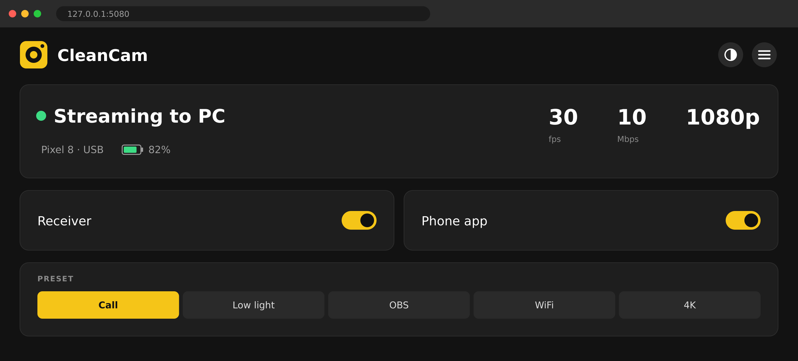

# CleanCam for Android

[CleanCam](https://github.com/dogkeeper886/cleancam) streams an iPhone's back camera, microphone and loudspeaker to a Linux PC, where Zoom, OBS or a browser lists them as the "CleanCam" webcam, microphone and speaker, with the camera's picture alone, free of the Camera app's buttons. CleanCam runs only on iPhones, and a Pixel owner wants the same clean webcam. The Pixel's camera then stays out of the call. **This repo builds CleanCam for Android, tested on a Pixel 8,** and a receiver that turns its stream into the same "CleanCam" devices on the PC.

## The CleanCam app

The app streams the back camera's frames instead of the screen, so the PC receives the clean picture, over the USB cable through adb or over WiFi.

- **Streams:** video on TCP port 5000 as H.264, or HEVC in the WiFi preset, at 1920x1080 or 3840x2160; the microphone on port 5001 as 48 kHz mono 16-bit PCM; the PC's speaker sound on port 5002, played on the loudspeaker; and a debug port on 5003.
- **Preview:** the phone shows the picture with a zoom slider from 0.5x to 8x, and chips that jump to the ultra-wide lens at 0.5x and the wide lens at 1x. The zoom label turns yellow past 2.1x, where 1080p starts to upscale.
- **Focus:** focus and exposure follow the largest face, or the center while no face shows. Tap the preview to hold them on a point; a long press hands them back.
- **Lock:** holds focus, exposure and white balance, so the picture stays steady.
- **Presets:** the gear button picks what you stream for, from the table below, and the app keeps the choice. Switching to or from WiFi or 4K reconnects the receiver within a second, and after 4K you pick the camera again in the video app.
- **Camera options:** the settings sheet holds one lens, Ultra wide or Wide, or lets Auto switch; picks the stabilization; shifts the exposure by up to 2 EV; fixes the white balance between 2500 and 8000 K, snapped to the camera's own lamp, fluorescent, daylight, cloudy and shade settings; turns on the macro focus for near subjects; and caps the bitrate at 20, 10, 6 or 3 Mbps. The app keeps them.
- **Stabilization:** Auto turns it off once the phone has stood still for 5 s and on once it has shaken for 5 s, as Cinematic in the OBS preset, at most once a minute. Cinematic is Android's preview stabilization, which steadies most but adds delay.
- **Heat guard:** on battery, the camera runs at 30 fps at most. When Android reports moderate throttling, it also drops 4K to 1080p, the bitrate by 30% and stabilization; at severe throttling, it streams 1080p30 at 6 Mbps. It eases back a minute after its last change.
- **Bitrate:** the video starts at 10 Mbps, 20 Mbps at 60 fps, or 40 Mbps in 4K, steps down by a fifth each second while the PC falls behind, and climbs back once the PC keeps up for 10 s.
- **Sound:** the app records and plays as a voice call does, so the phone's echo canceller removes the loudspeaker's sound from the microphone. It plays on the loudspeaker, or on a Bluetooth headset while one is connected, at the loudness the volume buttons set. **Mute** silences the PC's CleanCam microphone.
- **Screen off:** blacks out the phone at its lowest brightness while the stream keeps running. Tap the screen to bring it back.
- **Orientation:** the stream follows the phone upright or sideways. Upright frames get black bars, so the webcam keeps its 16:9 size.
- **Battery:** the app encodes only while a PC watches.
- **Low battery:** the status line shows the battery, which the app's hidden system bars would otherwise hide, in red at 15% or below. At 10% the app closes, plugged in or not, since a phone streaming over a PC's USB port can drain while plugged in; the settings sheet sets 5, 10 or 15%, or Never.
- **Auto off:** the app turns itself off once the phone stands still and untouched for 5 minutes while no app on the PC uses the CleanCam webcam or microphone, as the receiver reports. A phone on a mount in a call stands as still as a forgotten one, so the receiver's report keeps it on through the call. The settings sheet sets 1, 5, 15 or 30 minutes, or Never, and the status counts down the last 30 s.
- **Status:** a second line names the preset, the size, HEVC when it streams it, the frame rate, the bitrate, the lens, the stabilization, each changed option, the heat guard while it acts, and what focus follows, such as `Call · 1080p · 30 fps · 10.0 Mbps · Wide · Stab off · Center`.

| Preset | For | Frame rate on a Pixel 8 | Size | Codec | Bitrate |
|---|---|---|---|---|---|
| **Call**, the default | Zoom, Meet and Teams, which send 30 fps | 24–30 fps | 1920x1080 | H.264 | 10 Mbps |
| **Low light** | a brighter face in the dark | 15–30 fps | 1920x1080 | H.264 | 10 Mbps |
| **OBS** | apps that keep every frame | 60 fps | 1920x1080 | H.264 | 20 Mbps |
| **WiFi** | a better picture over a WiFi link | 24–30 fps | 1920x1080 | HEVC | 10 Mbps |
| **4K** | OBS over the USB cable | 24–30 fps | 3840x2160 | H.264 | 40 Mbps |

## How the pieces depend on each other

The PC builds the app with JDK 17, the Android SDK and Gradle, and installs it over adb. On the Pixel, the app uses Camera2, MediaCodec and the voice-call audio path of Android 17. Back on the PC, adb forwards the app's four ports over the USB cable to the receiver, which feeds the CleanCam webcam and sound devices that video apps open.

![Three columns of layers. Build on the Linux PC: Rocky Linux 9.8 holds JDK 17 and the Android SDK, which Gradle 9.6.0 with AGP 9.5 runs on and compiles against to build the APK; the APK installs over adb onto the phone. Phone, a Pixel 8: the Tensor G3 hardware, driven by Android 17 (API 37), on which Camera2, MediaCodec and the audio APIs run; the CleanCam app captures, encodes, records and plays with them, and serves TCP 5000–5003. Receive on the Linux PC: adb 37.0.1 forwards ports 5000–5003 over the USB cable to cleancam-receive.sh, which writes frames to the CleanCam webcam on v4l2loopback and feeds sound to the CleanCam microphone and speaker on PipeWire; video apps open them.](docs/diagrams/png/software-layers.png)

## Build and install

The app builds on the Linux PC from the command line alone, and uses only the Android framework and the Kotlin standard library.

1. **Set up the PC once.** The [`developing-cleancam-android`](.claude/skills/developing-cleancam-android/SKILL.md) skill installs JDK 17, the Android command-line tools, platform-tools, Android 17 and Gradle 9.6.0. Its [`one-time-setup.sh`](.claude/skills/developing-cleancam-android/one-time-setup.sh) adds the udev rule that lets your login reach the Pixel, and puts the SDK's adb ahead of the distribution's older one.
2. **Connect the Pixel** into a port on the PC itself, since a hub port can drop it. Turn on Developer options by tapping Settings → About phone → Build number seven times, then turn on USB debugging in Settings → System → Developer options, and tap Allow on the phone's prompt.
3. **Build:**
   ```sh
   ./gradlew assembleDebug
   ```
4. **Install:**
   ```sh
   adb install -r app/build/outputs/apk/debug/app-debug.apk
   ```
5. **Open CleanCam** on the phone and allow the camera, the microphone, and the local network for WiFi.

The app needs **Android 13 or later**. A debug build stays installed and opens until you remove it. The [`building-cleancam-android`](.claude/skills/building-cleancam-android/SKILL.md) skill lists the same steps for an agent, with the checks that the PC receives the stream.

## Use it on the PC

A phone on a mount as a webcam sits out of reach of its own screen. The CleanCam icon is the PC's one way in: a click starts the receiver, which turns the stream into the "CleanCam" webcam, microphone and speaker, and opens the control panel, a page at `http://127.0.0.1:5080` that turns the app on and off and changes its settings. Install it once; it asks for the sudo password:

```sh
panel/install.sh
```

It adds CleanCam to the desktop's app list, and loads the CleanCam webcam at every boot, so the icon starts the receiver without a password. Then click CleanCam, turn on Phone app, and pick "CleanCam" as the camera, the microphone and the speaker in the video app.



- **Main page:** the stream's state, the phone and its battery, the frame rate, the bitrate and the size, the Receiver and Phone app switches, and the preset.
- **Drawer:** ☰ lists Camera, Max bitrate, Auto off, Low battery and On the phone, with Mute, Lock and Screen off, and opens each in its own layer.
- **Theme:** ◐ switches between light and dark; the page starts in the PC's own setting.
- **Keeps running:** closing the browser leaves the panel and the receiver running. A click on the icon opens the same page, and starts the receiver again after the Receiver switch stopped it.
- **Keep CleanCam open:** Android stops the camera when the app leaves the screen. Use Screen off instead of locking the phone.
- **Auto off:** every 2 s, the receiver tells the app whether an app on the PC holds the CleanCam webcam open or records from the CleanCam microphone. The app counts toward auto off only while none does, and again 10 s after the receiver stops.
- **USB only:** the panel and the receiver reach the phone through adb, so plug the phone into a port on the PC itself. Streaming over WiFi has no way in from the icon yet.
- **Needs:** adb, ffmpeg, the v4l2loopback kernel module, with `v4l2loopback-ctl` when OBS loaded the module first, PipeWire with `pw-cli` or PulseAudio with `pactl` and `parec`, and `python3`.

## For developers

The icon runs `panel/cleancam-panel.py`, and the panel runs `receiver/cleancam-receive.sh`, CleanCam's receiver with `adb forward` in place of iproxy. A developer runs them directly to test a change; a user starts both from the icon alone.

```sh
panel/cleancam-panel.py --no-browser    # the panel, without opening the page
receiver/cleancam-receive.sh            # the receiver alone, phone on USB
receiver/cleancam-receive.sh 192.0.2.7  # the receiver alone, phone on the same WiFi, by its IP
```

- **USB:** the receiver forwards ports 5000 to 5003 with `adb forward`, sets them again after a replug, and removes them when it stops. Set `ANDROID_SERIAL` to pick one of several phones.
- **Check the sound:** `tools/mic-check.sh` records 5 s from the CleanCam microphone and plays it on the CleanCam speaker, so the phone plays back what its microphone heard.
- **Debug the stream:** `nc 127.0.0.1 5003` prints one JSON line a second: the frame rate, the target bitrate, the bits sent, the keyframes, the backlog, the viewers per port, the auto-off count, Mute, Lock and Screen off, and the battery, plus a line for each event. Keep `nc`'s input open, since the app drops a client that closes its sending side. Type `bitrate N`, `auto`, `keyframe`, `preset call|lowlight|obs|wifi|4k`, `lens auto|ultrawide|wide`, `stab auto|off|standard|cinematic`, `ev -2..2`, `wb auto|2500..8000`, `near on|off`, `maxbitrate off|N`, `autooff never|N` in minutes, `lowbattery never|N` in percent up to 15, `mute on|off`, `lock on|off`, `screen on|off`, `thermal nominal|fair|serious|critical|auto`, `battery unplugged|charging|auto`, or `camera`. The receiver sends `inuse on|off`.

The receiver reads these settings from the environment:

| Variable | Changes | Default |
|---|---|---|
| `PORT`, `AUDIO_PORT`, `SPEAKER_PORT`, `DEBUG_PORT` | the TCP ports for video, the microphone, the speaker and debugging; they must match the app's | `5000` to `5003` |
| `VIDEO_NR` | the webcam device number, `/dev/video<N>` | `10` |
| `VAAPI_DEVICE` | the GPU that decodes the video; empty decodes on the CPU | `/dev/dri/renderD128` |
| `ANDROID_SERIAL` | the phone adb forwards to, when several are connected | the only phone |

## Test cases

`test-cases/` holds 135 cases in 24 suites that the app has to pass on the Pixel 8, drawn from CleanCam's code and adapted to Android: [`suites.md`](test-cases/suites.md) lists them, and [`decision-tree.png`](test-cases/decision-tree.png) shows the session they come from.

## Tested

These ran on a Pixel 8 on Android 17 over the USB cable, with a Rocky Linux 9.8 PC on PipeWire:

| Checked | Result |
|---|---|
| Call preset | 1920x1080 H.264 at 30 fps and 10 Mbps, a keyframe every 2 s, in `/dev/video10` |
| OBS preset | 60 fps at 20 Mbps |
| WiFi preset | HEVC; the receiver reconnected within a second |
| 4K preset | 3840x2160 at 30 fps and 40 Mbps |
| Upright phone | the picture upright between black bars, as on the phone's screen |
| Microphone | sound data reaches the CleanCam microphone |
| Debug port | the `second`, `mode` and `camera` lines, and the `preset` and `camera` commands |
| Auto off | closes at the set time with the phone still and nothing using the stream; stays on while a PC app reads the webcam or records from the microphone, and while the phone moves |
| Control panel | the Receiver and Phone app switches, the five presets, the drawer's settings, and Mute, Lock and Screen off |
| Low battery | with the level faked by `adb shell dumpsys battery set level`: red at 14% on the phone and the panel, the app closed at 10% while plugged in, and again at once when opened at 10%; it stays on with Never |

**Still to check:** streaming over WiFi, the speaker's sound and the echo canceller by ear, the microphone's loudness with speech, the settings sheet by hand, the heat guard under real heat, a PC on PulseAudio, a tap restarting the auto-off count, and the icon after a reboot.
